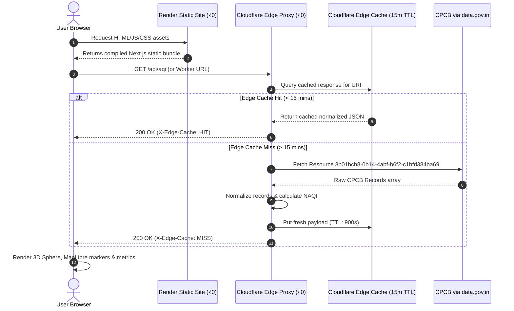

# AirScope India — System Architecture & Design Specification

## 1. Architectural Philosophy
AirScope India is engineered as an open, resilient, zero-marginal-cost environmental intelligence platform. The initial operational focus is the **National Capital Region (NCR)** of India—encompassing Delhi, Noida, Greater Noida, Gurugram, Faridabad, and Ghaziabad—with architectural readiness for pan-India expansion.

The system is designed according to four core architectural tenets:
1. **Zero Infrastructure Cost Base (₹0 Target)**: Utilizing Render's free static site hosting and Cloudflare's free serverless Edge Worker tier (100,000 req/day).
2. **Scientific & Legal Integrity**: Strict compliance with the official Central Pollution Control Board (CPCB) National Air Quality Index (NAQI) breakpoints, data sufficiency criteria, and the Government Open Data License - India (GODL). No fabricated interpolated readings between physical stations.
3. **Decoupled Data Providers**: A pluggable `AQIDataProvider` abstraction allowing seamless fallback between CPCB (via data.gov.in) and OpenAQ v3 without touching the presentation layer.
4. **Resilient Edge Caching & CORS Protection**: Browser clients never hold private government API keys, nor do they make direct cross-origin calls to upstream endpoints.

---

## 2. End-to-End System Data Flow



---

## 3. Data Provider Abstraction & Normalization Layer

The platform enforces a strict separation between upstream raw payloads and internal domain models through the `AQIDataProvider` interface:

```typescript
export interface AQIDataProvider {
  readonly id: string;
  readonly name: string;
  readonly attribution: ProviderAttribution;
  fetchStations(): Promise<StationMeasurement[]>;
  isConfigured(): boolean;
}
```

### 3.1 CPCB Provider (`src/lib/providers/cpcb.ts`)
- **Upstream Resource**: `api.data.gov.in/resource/3b01bcb8-0b14-4abf-b6f2-c1bfd384ba69`
- **Normalization Tasks**:
  1. Parses Indian timestamp format `DD-MM-YYYY HH:MM:SS` to standard UTC ISO 8601 strings.
  2. Aggregates pollutant rows by monitoring station (CPCB delivers one row per pollutant).
  3. Maps station names to verified spatial coordinates from the Delhi NCR CAAQMS station registry.
  4. Detects stale telemetry (>2 hours old) and tags readings accordingly.
  5. Computes individual pollutant sub-indices and overall station NAQI according to CPCB criteria.

### 3.2 OpenAQ v3 Provider (`src/lib/providers/openaq.ts`)
- **Upstream Resource**: `api.openaq.org/v3/locations` (NCR bounding box: `76.8,28.2,77.6,28.9`)
- **Role**: Secondary fallback provider if data.gov.in experiences downtime or rate throttling.

### 3.3 Provider Manager (`src/lib/providers/manager.ts`)
- Coordinates primary provider execution with automatic fallback.
- Computes aggregated municipal summaries (Delhi, Noida, Greater Noida, Gurugram, Faridabad, Ghaziabad).
- Provides an in-memory/edge TTL cache (15 minutes).

---

## 4. Scientific Calculation Methodology (CPCB NAQI)

AirScope India follows the official CPCB calculation formula without arbitrary modifications:

### 4.1 Sub-Index Calculation Formula
$$I_p = \frac{I_{high} - I_{low}}{C_{high} - C_{low}} \times (C_p - C_{low}) + I_{low}$$
Where:
- $C_p$: Monitored concentration of pollutant $p$.
- $C_{low}, C_{high}$: Concentration breakpoints enclosing $C_p$.
- $I_{low}, I_{high}$: Corresponding AQI sub-index scale values.

### 4.2 CPCB Data Sufficiency Rules
1. **Minimum Pollutants**: At least three distinct pollutants must be monitored.
2. **Mandatory Particulate Requirement**: At least one of $\text{PM}_{2.5}$ or $\text{PM}_{10}$ must be present.
3. **Station AQI**: Evaluated as the maximum (worst) sub-index across all valid pollutants:
   $$\text{NAQI} = \max(I_{\text{PM}_{2.5}}, I_{\text{PM}_{10}}, I_{\text{NO}_2}, I_{\text{SO}_2}, I_{\text{CO}}, I_{\text{O}_3}, I_{\text{NH}_3})$$

---

## 5. Component Hierarchy & User Interface Architecture

```
src/
├── app/
│   ├── layout.tsx             // Global metadata, Schema.org JSON-LD, dark background
│   ├── page.tsx               // Main intelligence dashboard
│   ├── [city]/page.tsx        // Static SSG city pages (/delhi, /noida, /gurugram, etc.)
│   ├── delhi/[locality]/page.tsx // Static SSG locality pages (/delhi/anand-vihar, etc.)
│   ├── api/aqi/route.ts       // Development / local proxy endpoint
│   ├── sitemap.ts             // XML sitemap generator
│   └── robots.ts              // Search crawler rules
├── components/
│   ├── Navigation.tsx         // Header, logo, search input, geolocation trigger
│   ├── HeroSection.tsx        // Editorial headline, 3D particle sphere, station card
│   ├── ThreeAQISphere.tsx     // Three.js atmospheric WebGL particle visualization
│   ├── PollutantCards.tsx     // PM2.5, PM10, NO2, SO2, CO, O3, NH3 breakdown
│   ├── InteractiveMap.tsx     // MapLibre GL 3D Delhi NCR map & custom marker popups
│   ├── PollutionInsights.tsx  // Worst/best stations, city rankings, scientific note
│   ├── LocationComparisonTable.tsx // Filterable, searchable, sortable comparison table
│   ├── HealthAdvisory.tsx     // CPCB health impact, masks, purifiers, outdoor exercise
│   ├── AffiliateShowcase.tsx  // Independent HEPA & N95 gear guide with disclosures
│   ├── AdSlot.tsx             // CLS-protected sponsor slots (toggleable via ENV)
│   ├── ShareModal.tsx         // WhatsApp, X, and link sharing card generator
│   └── Footer.tsx             // Legal disclaimer, GODL attribution, locality directory
```

---

## 6. Security & Operational Reliability

1. **Zero Credential Leakage**: No private keys are baked into client-side bundles. Upstream keys remain strictly inside the Cloudflare Worker environment secret store.
2. **CORS Hardening**: Edge proxy injects explicit `Access-Control-Allow-Origin` headers.
3. **Rate Limiting Protection**: 15-minute edge caching ensures upstream government endpoints are queried at most 4 times per hour per endpoint, easily remaining within public API limits.
4. **Graceful Degradation**:
   - WebGL unavailable -> Map and 3D sphere fall back cleanly without breaking DOM rendering.
   - Geolocation rejected -> User experiences full functionality via manual search and locality selectors.
   - Upstream API downtime -> Displays clear, labeled service status rather than fabricated numbers.
